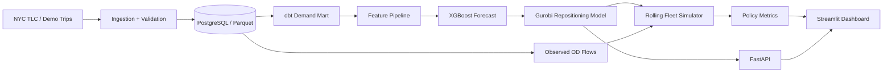
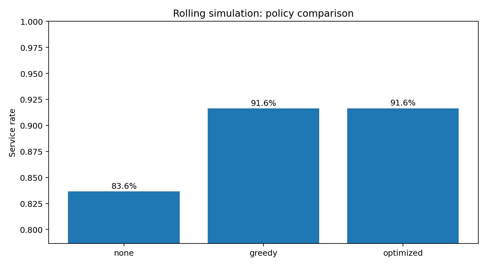
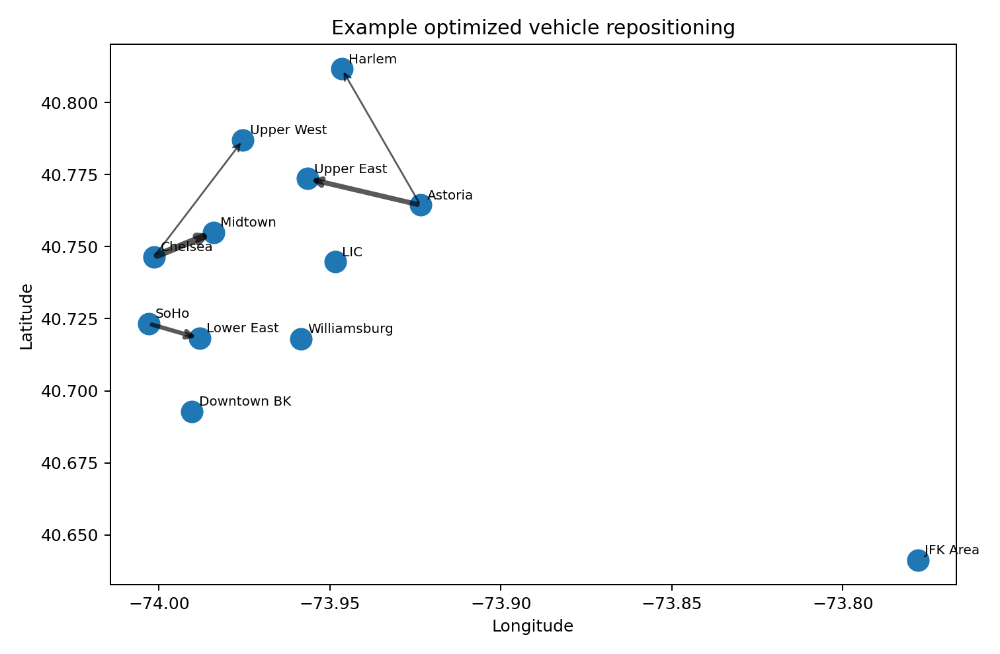

<p align="center">
  
</p>

<p align="center">
  <strong>Forecast urban ride demand. Reposition vehicles with mathematical optimization. Simulate the operational impact.</strong>
</p>

<p align="center">
  
  
  
  
  
  
</p>

# NYC Dynamic Fleet Repositioning Platform

An end-to-end **data engineering + data science + operations research** system that turns raw trip records into operational fleet decisions.

The platform ingests NYC TLC-style trip data, creates time-zone demand features, trains a short-horizon forecasting model, solves a vehicle-repositioning optimization problem, and evaluates the policy in a rolling simulation. It exposes the decision engine through a FastAPI service and an interactive Streamlit dashboard.

> **Portfolio thesis:** forecasting tells us what is likely to happen; optimization decides what to do about it.

## What this project demonstrates

| Layer | What is implemented | Skills shown |
|---|---|---|
| Data engineering | Raw ingestion, validation, dimensional SQL models, Parquet-ready storage, orchestration | Python, SQL, PostgreSQL, dbt, Airflow, data modeling |
| Data science | Time-based feature engineering, baselines, gradient-boosted demand forecasting, time split evaluation | pandas/Polars-ready workflows, scikit-learn, XGBoost, MLflow-ready experiment tracking |
| Operations research | Integer vehicle repositioning with unmet-demand penalties and movement costs | LP/MILP, network flow, Gurobi, sensitivity analysis |
| Simulation | Rolling state transitions with realized origin-destination flows | discrete simulation, policy evaluation, counterfactuals |
| Software engineering | API, dashboard, configuration, tests, Docker, CI | FastAPI, Streamlit, pytest, GitHub Actions |

## System architecture



## Optimization model

For each decision interval, let:

- `x[i,j]` = vehicles repositioned from zone `i` to `j`
- `u[j]` = predicted demand left uncovered in zone `j`
- `v[i]` = current available vehicles
- `d[j]` = predicted demand
- `c[i,j]` = repositioning travel cost

The model minimizes

$$
\min \; \lambda_u \sum_j u_j + \lambda_r \sum_{i \ne j} c_{ij}x_{ij}
$$

subject to

$$
\sum_{j \ne i} x_{ij} \le v_i \qquad \forall i
$$

$$
v_j - \sum_{k \ne j} x_{jk} + \sum_{i \ne j} x_{ij} + u_j \ge d_j \qquad \forall j
$$

$$
x_{ij} \in \mathbb{Z}_{\ge 0}, \qquad u_j \ge 0
$$

This is a capacitated network-flow style mixed-integer model. The primary implementation uses **Gurobi**; a SciPy MILP fallback keeps the demo fully runnable.

## Repository tour

```text
nyc-fleet-optimizer/
├── app/                       # Streamlit decision-support UI
├── airflow/dags/              # scheduled pipeline DAG
├── assets/                    # GitHub visuals + generated demo plots
├── config/                    # reproducible model/simulation settings
├── dbt/fleet_dbt/             # staging + demand mart SQL models
├── docs/                      # formulation, architecture, interview guide
├── scripts/                   # bootstrap, download, train, simulate
├── src/fleetopt/
│   ├── api/                   # FastAPI service
│   ├── data/                  # TLC loader + demo generator
│   ├── features.py            # time-zone feature engineering
│   ├── forecasting.py         # baseline + XGBoost training
│   ├── optimization.py        # Gurobi/SciPy repositioning model
│   ├── simulation.py          # rolling fleet simulation
│   └── evaluation.py          # policy + forecast metrics
└── tests/                     # unit and integration tests
```

## Quick start: zero external data required

```bash
python -m venv .venv
source .venv/bin/activate
pip install -e ".[dev,app]"
make demo
```

`make demo` will:

1. generate deterministic TLC-style synthetic trip records,
2. aggregate demand into 30-minute zone intervals,
3. build lag/seasonality features,
4. train a forecasting model,
5. simulate no-repositioning and optimized policies,
6. write metrics and figures to `artifacts/`.

Then launch the dashboard:

```bash
streamlit run app/streamlit_app.py
```

Or the API:

```bash
uvicorn fleetopt.api.main:app --reload
```

## Run on official NYC TLC data

The downloader follows the TLC monthly trip-file convention:

```bash
python scripts/download_zones.py
python scripts/download_tlc.py --year 2025 --months 1 2 3 --color yellow
python scripts/run_pipeline.py --input data/raw/yellow_tripdata_2025-01.parquet data/raw/yellow_tripdata_2025-02.parquet data/raw/yellow_tripdata_2025-03.parquet
```

For a laptop-friendly portfolio run, use a few months and filter to a selected set of zones. The code is structured so the storage/aggregation layer can be moved to PostgreSQL/dbt without changing the modeling layer.


## Verified demo results

The repository includes a deterministic 24-day synthetic benchmark so every clone can reproduce the same end-to-end run. A snapshot of the benchmark output is committed under `examples/`. These are **demo results, not claims about real NYC operations**.

| Metric | Result |
|---|---:|
| XGBoost demand MAE | **2.64 trips / zone-interval** |
| Seasonal-naive MAE | 3.63 |
| Forecast MAE improvement | **27.3%** |
| No-reposition service rate | 83.6% |
| Optimized service rate | **91.6%** |
| Reduction in unserved demo trips | **48.8%** |
| Reposition vehicle-minutes vs greedy | **3.9% lower** |

<p align="center">
  
</p>

The optimized and greedy policies reach almost identical service levels in this benchmark, but the optimizer uses fewer reposition vehicle-minutes because movement cost is explicitly represented in the objective. That is the behavior the model is intended to expose: **service quality versus operating cost**, not an optimizer that wins every metric by construction.

## Dashboard

<p align="center">
  
</p>

The dashboard is designed around the questions an operations team would ask:

- Where will demand be highest in the next interval?
- Where are vehicles currently over- or under-supplied?
- Which repositioning moves does the optimizer recommend?
- How much demand is expected to remain uncovered?
- How does the optimized policy compare with no repositioning?

## Experiment design

The project compares three decision policies:

1. **No repositioning**: vehicles simply remain where the prior trip flows leave them.
2. **Greedy heuristic**: surplus zones send vehicles to the highest shortfall zones.
3. **Optimization**: integer network-flow model trades off unmet demand and repositioning cost.

Evaluation focuses on **decision quality**, not only forecasting accuracy:

- demand MAE / RMSE,
- service rate,
- unserved trips,
- repositioned vehicles,
- repositioning distance proxy,
- fleet utilization,
- total operational objective.

## Data engineering path

The lightweight demo runs directly from CSV so anyone can clone it. The production-shaped path is included separately:

```text
TLC files
  ↓
Airflow ingestion
  ↓
raw.trips (PostgreSQL)
  ↓
dbt staging models
  ↓
marts.zone_demand_30m
  ↓
forecast + optimizer
```

The dbt project demonstrates staging/mart separation, tests, and SQL transformations. The Airflow DAG demonstrates repeatable orchestration without forcing heavy infrastructure on first-time users.

## API example

`POST /optimize`

```json
{
  "vehicles": {"1": 18, "2": 5, "3": 12},
  "forecast_demand": {"1": 8, "2": 14, "3": 10},
  "cost_matrix": [
    [0, 8, 15],
    [8, 0, 6],
    [15, 6, 0]
  ],
  "solver": "auto"
}
```

Response:

```json
{
  "status": "optimal",
  "objective": 23.8,
  "moves": [
    {"origin": 1, "destination": 2, "vehicles": 7},
    {"origin": 3, "destination": 2, "vehicles": 2}
  ],
  "unmet_demand": {"1": 0.0, "2": 0.0, "3": 0.0}
}
```

## Engineering decisions

**Why a deterministic demo dataset?** A public portfolio repository should work immediately. The synthetic generator mirrors TLC fields and realistic temporal/spatial demand patterns, while the official downloader supports real-data experiments.

**Why rolling simulation?** A one-shot optimizer can look impressive while producing poor operational decisions. Rolling simulation forces the policy to live with the vehicle state it creates.

**Why both Gurobi and an open fallback?** Gurobi is the stronger OR portfolio signal; the fallback prevents licensing from blocking reproducibility.

**Why a time split instead of random train/test?** Demand forecasting is temporal. Random splits leak future patterns into training and overstate performance.

## Local development

```bash
make install
make test
make demo
make api
make app
```

### Optional PostgreSQL + Airflow-shaped stack

```bash
docker compose up --build
```

## Roadmap

- probabilistic demand forecasts and scenario-based optimization,
- travel-time matrix from a road-network API or historical trip times,
- multi-period optimization rather than one-period receding horizon,
- fairness/service-level constraints by borough,
- model monitoring and forecast-drift checks,
- cloud deployment and scheduled daily retraining.

## License

MIT. Data downloaded from NYC TLC remains subject to the source provider's terms and documentation.
